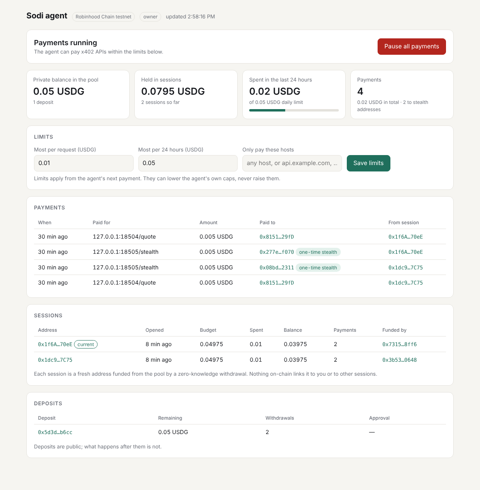

# Sodi Dashboard

**The owner's view of an rx402 agent: a kill switch, spending limits, and everything it has paid.**

The dashboard runs on the same machine as the agent and reads the same files. It doesn't hold any keys, and it doesn't need the agent to stop.

- **Kill switch.** One click and the agent refuses every payment until you resume. It takes effect on the agent's next request, with no restart.
- **Limits.** Cap each request and each rolling 24 hours, and restrict payments to listed hosts. They can lower the agent's own caps, never raise them.
- **History.** Every payment, with what it paid for, how much, which session paid it, and whether it went to a merchant's one-time stealth address.
- **Sessions and deposits.** What's private in the pool, what each session address still holds on-chain, and the zero-knowledge withdrawal that funded it.
- **Read-only link.** Optionally, a second link that shows everything but can't change anything, for an accountant on the same machine. For anyone else, use [Sodi Disclosure](../disclosure).



## Run it

```sh
npm start --workspace dashboard
# Sodi dashboard: http://127.0.0.1:8480/#token=…
```

Open the printed link. It carries the access token, and a new one is made each time the dashboard starts.

| Variable | Default | |
| --- | --- | --- |
| `RX402_STORE` | `~/.sodi/rx402.json` | The agent's store, as used by the Sodi MCP server |
| `RX402_CONTROLS` | `~/.sodi/controls.json` | Where the kill switch and limits are written |
| `RPC_URL` | Robinhood Chain testnet | For session balances |
| `ASP_URL` | unset | Approval service, for deposit status |
| `DASHBOARD_PORT` | `8480` | |
| `DASHBOARD_READ_ONLY` | unset | `1` also prints a read-only link |

The agent side is built into rx402: pass `controls: new FileControls(path)` to `Rx402Client`. The Sodi MCP server does this by default.

## How the controls work

The controls are a small JSON file. The agent reads it before every payment, so the dashboard and the agent never have to talk to each other, and you can also edit the file by hand. If the file can't be read, the agent treats it as paused, so a broken kill switch fails safe.

```json
{ "paused": false, "maxPaymentAmount": "100000", "dailyLimit": "2000000", "allowedHosts": ["api.example.com"] }
```

Amounts are USDG base units (6 decimals).

## Security

- Listens on `127.0.0.1` only, and refuses requests addressed to any other host name, which blocks DNS rebinding.
- The token travels in an `Authorization` header, never a cookie, so other websites open in your browser can't act as you.
- Session private keys stay in the store; the API never returns them.
- Strict content security policy; no third-party scripts, fonts or images.

## Tests

`npm test --workspace dashboard`: totals and history, that no private keys are exposed, rendering with the chain or approval service down, input validation, token checks, the Host check, the read-only link, and controls written to the file the agent reads. The rx402 suite tests the agent side: the kill switch taking effect without a restart, per-request and 24-hour caps, allowed hosts, and failing closed on an unreadable file.
