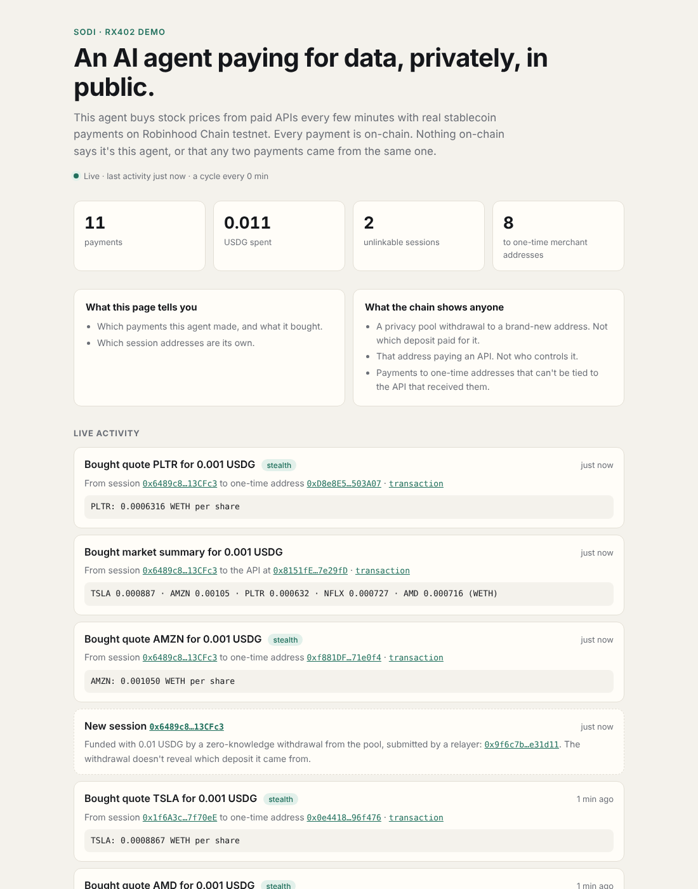

# Sodi Demo Agent

**An AI agent paying for data, privately, in public.**

A small agent that buys stock prices from paid APIs every few minutes, with real USDG on Robinhood Chain testnet, through the full Sodi stack. A public page shows everything it does. Anyone can check each payment on the explorer, and see that nothing on-chain ties the payments to this agent or to each other.



## What runs

| Piece | What it does |
| --- | --- |
| The agent | Each cycle buys one stock quote and, every third cycle, a market summary, using `Rx402Client`. It rotates to a fresh session every ten payments. |
| Two x402 APIs | Serve real on-chain data: prices of the testnet stock tokens (TSLA, AMZN, PLTR, NFLX, AMD) from the testnet DEX's pools. The quote API offers a stealth address; the market API is an ordinary x402 API. |
| Approval service and relayer | The same code as [`asp/`](../asp) and [`relayer/`](../relayer), run in-process for convenience. |
| Public page | `/` and `/feed.json`, refreshed every 15 seconds. |

The feed holds only what's on-chain, plus the one thing the chain doesn't say: which sessions belong to this agent. Keys never appear in it.

The owner can pause the agent or cap its spending from the [dashboard](../dashboard) by pointing both at the same `RX402_CONTROLS` file.

## Run it

Fund the agent's pool first: deposit USDG with `Rx402Client.deposit` using the same mnemonic and store. Then:

```sh
RX402_MNEMONIC="…" RX402_STORE=~/.sodi/demo-store.json RX402_CONTROLS=~/.sodi/demo-controls.json \
POSTMAN_PRIVATE_KEY=0x… RELAYER_PRIVATE_KEY=0x… FACILITATOR_PRIVATE_KEY=0x… MERCHANT_PRIVATE_KEY=0x… \
SETTLER=0x271320B5dF6fc8Dc778304f53B1D7b01B0c2855E FEED_FILE=~/.sodi/demo-feed.json \
npm start --workspace demo-agent
```

| Variable | Default | |
| --- | --- | --- |
| `DEMO_INTERVAL` | `300` | Seconds between cycles |
| `DEMO_CYCLES` | `0` | Stop after this many cycles; `0` runs until stopped |
| `PUBLIC_PORT` / `PUBLIC_HOST` | `8490` / `0.0.0.0` | The public page |
| `RPC_URL` | Robinhood Chain testnet | |

Each API call costs 0.001 USDG, and each session is funded with exactly ten calls' worth plus the relayer's fee. 0.1 USDG keeps it running for about six hours at the default interval. Gas is paid by the relayer and facilitator wallets, at a fraction of a cent per cycle.

To keep it up, run it under a process manager on any small server (`pm2 start "npm start --workspace demo-agent"`, or a systemd unit), and put the public port behind HTTPS.

## Live run

On 2026-10-23 it ran live on Robinhood Chain testnet for eight cycles: 11 payments (8 to one-time stealth addresses) and one new session funded by a relayed zero-knowledge withdrawal. All 12 transactions succeeded. The feed is in [`docs/feed-2026-10-23.json`](./docs/feed-2026-10-23.json).

It isn't hosted anywhere yet; it needs a small always-on server.

## Tests

`npm test --workspace demo-agent`: the buying schedule, new sessions logged before the payment they funded, pauses and empty pools reported once rather than every cycle, and the feed surviving restarts without keys in it.
